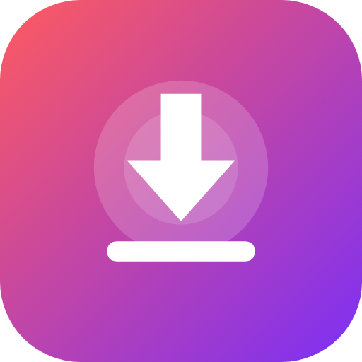
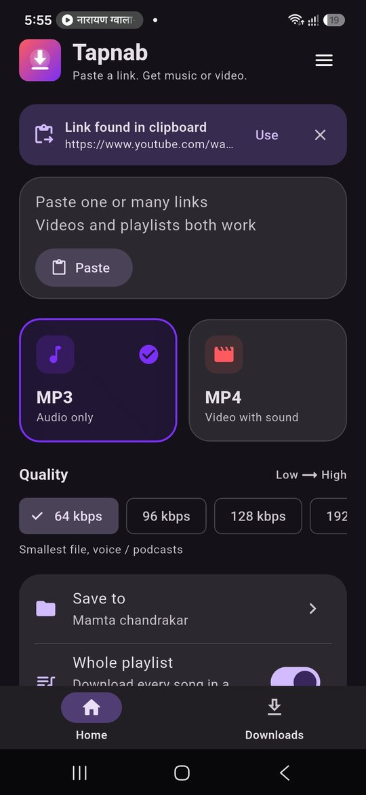
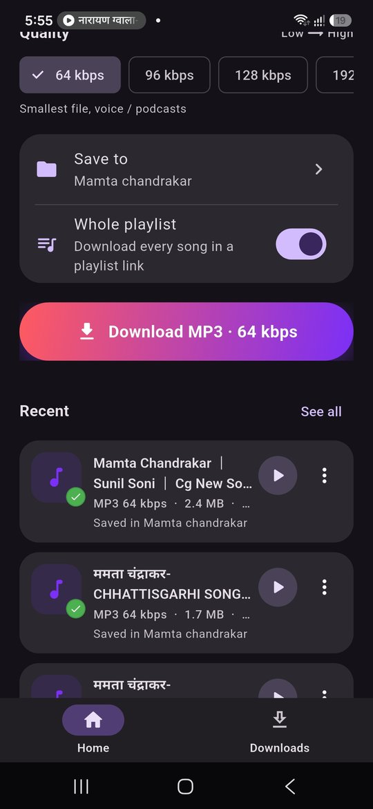
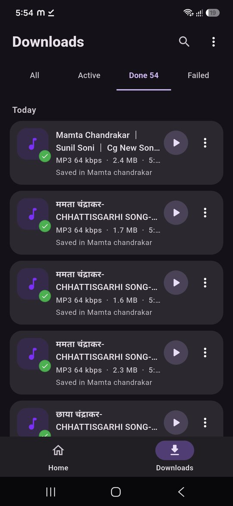

<p align="center">
  
</p>

<h1 align="center">Tapnab</h1>
<p align="center"><b>Share a link. Pick a quality. Get an MP3 or MP4.</b><br>
A simple Android downloader that runs entirely on your phone. No account, no API key, no server.</p>

---

## Screenshots

<p align="center">
  
  &nbsp;
  
  &nbsp;
  
</p>

## Features

- **Pop-up over YouTube:** Share → Tapnab opens a small window right over YouTube. Pick MP3/MP4 and quality, tap Download, and you are back in YouTube.
- **Browse tab:** YouTube inside Tapnab. A floating **Download** button appears on any video or playlist.
- **MP3 or MP4**, with quality listed from low to high:
  - MP3: 64 · 96 · 128 · 192 · 256 · 320 kbps
  - MP4: 144p · 240p · 360p · 480p · 720p · 1080p · 1440p · 2160p · Best available
- **Many links at once:** paste a list, every link becomes a queued download (1 to 4 run in parallel).
- **Pick songs from a playlist** before downloading, with "already downloaded" marked. Songs are saved in a folder named after the playlist.
- **Tidy file names:** "(Official Video)" tags and "| Channel" endings are removed (Original / Clean / Short styles).
- **Cover art and tags** in MP3 files (thumbnail as album art).
- **Downloads manager** like a browser's: All / Active / Done / Failed, grouped by date, search, sort, MP3/MP4 filter.
- **Select many:** long-press to select, then **Play** in your music player, Share, Delete or Retry together.
- **Duplicate detection:** warns before downloading the same video twice.
- **Choose where files go**, like in Acode: saved folder list, tap to select, ✕ to forget, "Select folder" to add one. Works with internal storage, SD cards and **USB pendrives**.
- **Settings:** Wi-Fi only, parallel downloads, file names, cover art, playlist folders, theme (system / light / dark).
- **Self-updating engine:** the bundled yt-dlp refreshes itself about once a day (or tap Update now), so downloads keep working when YouTube changes.
- **Keeps going in the background** with a progress notification.
- **Plain files:** standard `.mp3` / `.mp4`, safe for FAT32/exFAT drives.

## No API key, no internet service of ours

Tapnab bundles [yt-dlp](https://github.com/yt-dlp/yt-dlp) and FFmpeg inside the app
(through [youtubedl-android](https://github.com/yausername/youtubedl-android)).
Everything runs on the device. You only need an internet connection to download a video.
Building it needs no account or key either.

## Build it

Requirements: Flutter 3.29+ (stable), Android SDK, JDK 17, Python 3.

```bash
git clone <your-repo-url> tapnab && cd tapnab
./setup.sh                                    # generates the Gradle project and patches it
flutter test
flutter build apk --release --split-per-abi   # APKs in build/app/outputs/flutter-apk/
```

Install the `arm64-v8a` APK on almost any phone made in the last several years.
`flutter run` works for development on a connected phone.

The first launch takes a few seconds longer while the bundled yt-dlp unpacks.
Minimum Android version: 10 (API 29).

### Signed releases (optional)

Create `android/key.properties` (git-ignored):

```properties
storeFile=release.jks
storePassword=...
keyAlias=...
keyPassword=...
```

The GitHub workflow in `.github/workflows/build.yml` builds on every push, and on a `v*` tag it attaches the
APKs to a release. Add the repository secrets `KEYSTORE_BASE64`, `KEYSTORE_PASSWORD`, `KEY_ALIAS`, `KEY_PASSWORD`
to sign them.

## Playing offline on another device (pendrive)

The files are ordinary MP3/MP4, so any player can open them. Two ways to get them onto a pendrive:

1. **Save straight to the pendrive.** Plug it into the phone (OTG adapter), then in Tapnab tap the folder row →
   **Select folder** → choose the drive, create a folder (for example `Music`), and tap *Use this folder*.
   It stays in your folder list for next time.
2. **Copy later.** Download to the default location (`Music/Tapnab` and `Movies/Tapnab`), then copy with any file manager.

Compatibility tips:

| Situation | Advice |
|---|---|
| Old TV, car stereo, DVD player | Use **MP4 up to 1080p** (Tapnab prefers H.264 + AAC, which they play) or **MP3** |
| 1440p / 2160p / "Best" | YouTube only offers these as VP9/AV1, which older devices may not play. Modern TVs and phones are fine |
| Pendrive formatted **FAT32** | A single file can't exceed 4 GB. Use exFAT for long 4K videos |

## How it works

```
Flutter UI ──MethodChannel / EventChannel──▶ MainActivity ─▶ DownloadManager (queue, 2 workers)
                                                                │
                                                 yt-dlp + FFmpeg (youtubedl-android)
                                                                │ cache dir
                                                          FileSaver ─▶ chosen folder (SAF)  or  MediaStore Music/Movies
DownloadService (foreground) keeps the process alive while the queue is busy.
```

| Path | Purpose |
|---|---|
| `lib/models` | Quality tables, task and folder models |
| `lib/state` | `DownloadController`, the only state holder |
| `lib/ui` | Home screen, quality selector, Acode-style folder dialog, task tiles |
| `android/app/src/main/kotlin/com/tapnab/app` | Queue, yt-dlp options, saving, folder grants, service |
| `tool/patch_gradle.py` | Adds dependencies, ABI filters and release signing to the generated Gradle file |

## Troubleshooting

- **"YouTube blocked this request"** → Settings → *Update now*, then retry. YouTube changes often.
- **A video fails but others work** → it may be private, age-restricted or region-locked.
- **Saved folder disappeared from the list** → Android revoked access (drive removed or reformatted). Select it again.

## Responsible use

Download only content you have the right to save: your own uploads, Creative Commons or public-domain videos,
or anything the owner permits. Downloading from YouTube can break its Terms of Service, and copyrighted
material shouldn't be saved without permission. You are responsible for how you use this app.

## License

MIT. See [LICENSE](LICENSE). Bundled components keep their own licenses (yt-dlp: Unlicense, FFmpeg: LGPL/GPL, youtubedl-android: GPL-3.0).
